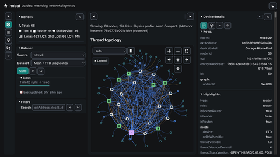
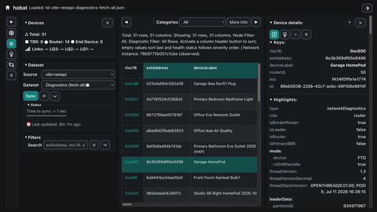

# Hobat screenshots

Desktop and mobile examples of Hobat's network-operator workflows.
Click a thumbnail to open its full-size image.

[View the rendered gallery on GitHub](https://github.com/jhawk42/smarthome/blob/main/hobat/screenshots.md)
if you are reading the raw Markdown.

## Topology with selected device

Inspect a device in the context of its mesh connections.

## OTBR diagnostics table

Compare device evidence in the tabular diagnostics view.

## Health insights

Review the network health assessment and its findings.

## Mobile diagnostics

View device diagnostics in a compact mobile layout.

## Multi-source evidence

Inspect a dataset combining evidence from multiple sources.

