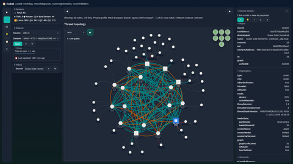
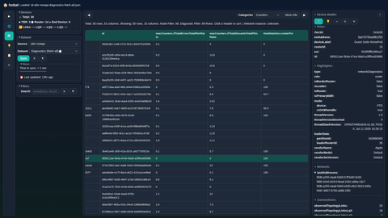
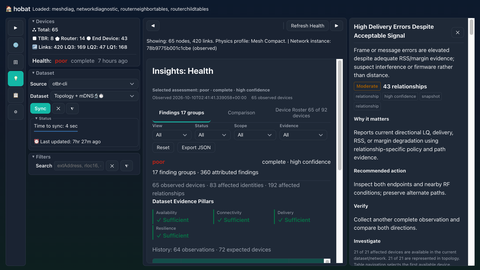
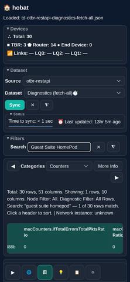
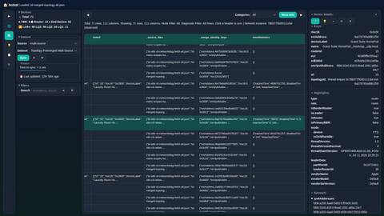

# Hobat screenshots

Click a thumbnail to open its full-size image.

[View the rendered gallery on GitHub](https://github.com/jhawk42/smarthome/blob/main/hobat/screenshots.md)
if you are reading the raw Markdown.

## Topology with selected device

## OTBR diagnostics table

## Health insights

## Mobile diagnostics

## Multi-source evidence

